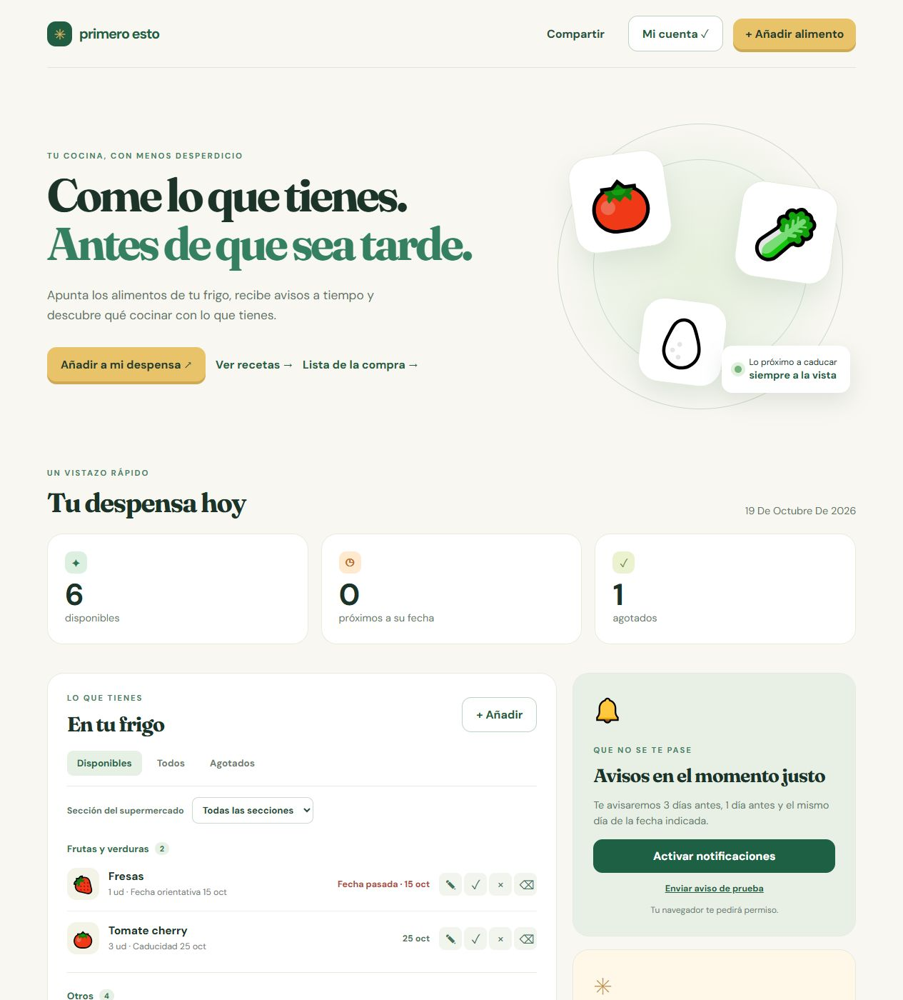
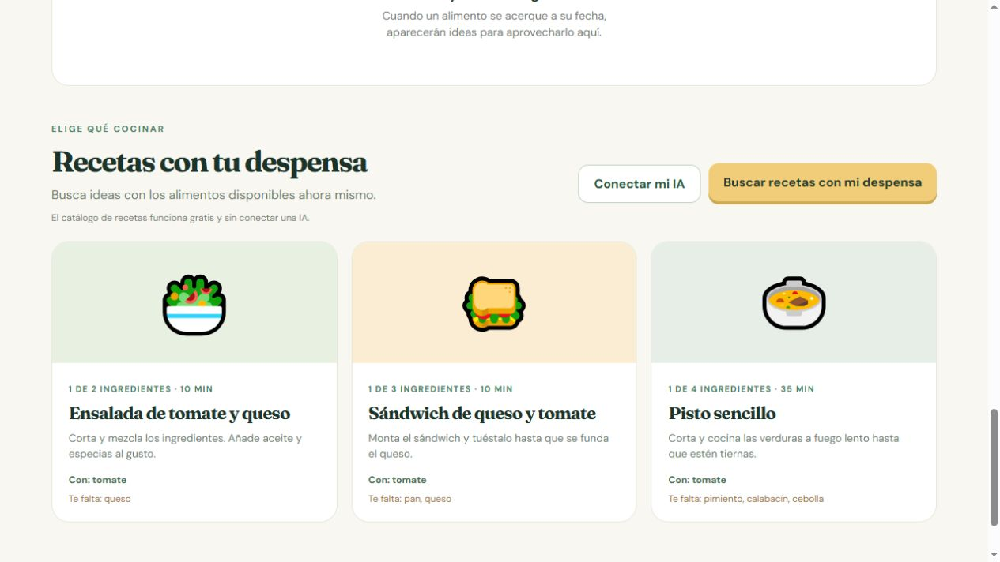

# Primero esto — documentación técnica

**Hackathon de Vibe Coding · Máster en Inteligencia Artificial, edición 7 · 19 de octubre de 2026**

**Aplicación:** https://primero-esto.seve-103.workers.dev/  
**Código:** https://github.com/seveluna/primero-esto

## 1. Problema y solución

Muchos alimentos se olvidan en el frigorífico hasta que caducan. «Primero esto» permite registrar manualmente qué hay, cuándo conviene consumirlo y qué se ha agotado. Avisa antes de la fecha indicada, sugiere recetas con los productos disponibles y convierte lo agotado en una lista de la compra. Una cuenta permite recuperar la misma despensa desde distintos dispositivos.

El MVP funciona sin inteligencia artificial externa: utiliza un catálogo de recetas local. Opcionalmente, cada usuario puede conectar su propio proveedor de IA y su propia clave API para generar ideas de cocina bajo demanda. La lectura de productos mediante fotografías se probó y se retiró porque no reconocía las etiquetas con suficiente fiabilidad.

## 2. Plataforma de desarrollo y tecnologías

El desarrollo se realizó con **Codex** a partir de instrucciones en lenguaje natural, iterando sobre una aplicación real. Se utilizó Cloudflare como infraestructura por su sencillez y coste inicial reducido. El repositorio contiene el código fuente y las migraciones.

| Capa | Tecnología | Función |
| --- | --- | --- |
| Interfaz | HTML, CSS y JavaScript; PWA | Formularios, despensa, compra, recetas y uso móvil |
| Backend | Cloudflare Worker | API, autenticación, control de acceso y programación de avisos |
| Base de datos | Cloudflare D1 | Cuentas, despensas, alimentos, sesiones, compra y notificaciones |
| Avisos | Service worker, Web Push, VAPID y Cron Trigger | Notificaciones en dispositivos suscritos |
| IA opcional | OpenAI, Gemini, Claude u OpenRouter | Recetas a petición del usuario que aporta su clave |

## 3. Arquitectura y datos

El mismo Worker sirve los archivos estáticos y responde a la API. D1 guarda los datos persistentes. Cada cuenta se vincula a una despensa; después de iniciar sesión, el navegador recibe una cookie de sesión `Secure`, `HttpOnly` y `SameSite=Lax`. La contraseña se deriva con sal aleatoria y PBKDF2-SHA-256; la base no guarda contraseñas en claro. Las operaciones de escritura comprueban la sesión en el servidor. Los enlaces de invitación permiten leer una despensa compartida, pero no modificarla.

El navegador consulta cambios periódicamente mientras la página está visible para reflejar modificaciones de otros dispositivos. Un Cron diario examina las fechas en D1 y prepara avisos 3 días antes, 1 día antes y el mismo día, evitando duplicados. El service worker recibe Web Push aunque la página esté cerrada, cuando el dispositivo y el navegador lo permitan y el usuario haya concedido permiso.

Las claves de proveedores de IA son opcionales y propias de cada cuenta. Se cifran antes de guardarse en D1 mediante una clave secreta del Worker (`AI_SETTINGS_KEY`); no se devuelven al navegador. Al pedir recetas se envían al proveedor elegido los nombres, cantidades y fechas de los alimentos disponibles. Puede haber cargos en la cuenta API del usuario. Sin una clave conectada, el catálogo local sigue funcionando.

## 4. Funciones y casos de uso

1. Crear una cuenta y abrir la misma despensa desde otro dispositivo.
2. Añadir manualmente un alimento con nombre, cantidad, unidad, sección del supermercado, fecha y tipo de fecha; editarlo después.
3. Distinguir caducidad, consumo preferente y fecha orientativa de frescura. Para algunas frutas y verduras, sugerir una duración aproximada a partir de la entrada en el frigo; el usuario puede corregirla.
4. Filtrar y agrupar los alimentos por estado y sección del supermercado.
5. Marcar como agotado un alimento. Desaparece de las recetas y entra en la lista de la compra, desde donde se puede reponer con una nueva fecha.
6. Consultar recetas automáticas cuando se acerca una fecha y pulsar «Buscar recetas con mi despensa» cuando se quiera cocinar con lo disponible.
7. Activar avisos push y compartir una vista de solo lectura de la despensa.
8. Conectar una IA propia si se desean recetas generadas, sin exigirla para el uso básico.

Para probar la aplicación, se puede registrar una cuenta de prueba desde «Mi cuenta» y cargar «Datos de ejemplo». No se necesitan credenciales preexistentes. Esta versión no verifica el correo ni ofrece recuperación de contraseña.

## 5. Desarrollo iterativo, retos y soluciones

**Idea inicial.** El participante planteó registrar compras y fechas, recibir avisos y aprovechar los ingredientes en recetas. Primero se exploró Firebase; después se eligió Cloudflare. Se implementó una interfaz adaptada al móvil, Worker, D1, recetas locales y avisos Web Push.

**Entrada de datos.** Se ensayó la incorporación por foto de productos y etiquetas. Como la lectura no era fiable, se eliminó de la app publicada y se mantuvo el registro manual. Esto evita guardar nombres o fechas mal reconocidos.

**Persistencia y acceso.** Se añadieron registro e inicio de sesión para sincronizar la despensa. Se conservan los alimentos de una despensa inicial al crear la cuenta. El backend rechaza escrituras de visitantes anónimos y de quienes acceden por enlace compartido. En producción se ajustó PBKDF2 al límite de iteraciones permitido por Workers mediante dos pasadas consecutivas.

**Uso diario.** Se añadió edición posterior, clasificación como en el supermercado y lista de la compra derivada de productos agotados. Para fruta y verdura se incorporaron fechas orientativas separadas de las fechas del envase; son estimaciones de calidad, no de seguridad alimentaria. Se corrigió el alto y desplazamiento de los modales para pantallas estrechas.

**Recetas e IA.** Además de recetas automáticas por proximidad de fecha, se agregó el botón para buscarlas con la despensa actual. El participante pidió que cada usuario pudiera aportar su propia API; se integraron proveedores opcionales con claves cifradas en el servidor. Una futura clave común de pago es una idea, no una función de esta entrega.

**Corrección en producción.** Una prueba con OpenAI descubrió que Cloudflare Workers rechazaba la opción `redirect: "error"` antes de hacer la llamada. Se cambió por `redirect: "manual"` y se comprueba expresamente cualquier redirección. También se configuró el identificador de modelo `gpt-4.1-mini`. Se verificó la respuesta real de OpenAI: tres recetas generadas a partir de la despensa de prueba.

## 6. Comprobaciones y límites

Se verificaron el alta y edición de alimentos, la persistencia en D1, el acceso desde otra sesión, la lista de la compra, la protección de escrituras, las fechas orientativas, el catálogo de recetas y los formularios en anchos de 390 y 320 píxeles. El envío real de push a un smartphone y la recepción del Cron programado requieren comprobación en un dispositivo compatible; el entorno de navegador usado para pruebas no permitió validar esa entrega de extremo a extremo. Las recetas de IA dependen de la validez, cuota y disponibilidad del proveedor que conecte cada usuario.

Las estimaciones de productos frescos se basan en la guía de la Universidad de Maine: https://extension.umaine.edu/food-health/2025/05/29/storing-and-washing-fresh-fruits-and-vegetables/ . No sustituyen la fecha del fabricante ni la inspección del alimento.

## 7. Capturas de la aplicación

**Pantalla principal y despensa de ejemplo.**

**Sección de recetas y botón de generación a petición.**

## 8. Acceso al código y despliegue

El código fuente, esquema D1, migraciones y comandos locales están en el repositorio. La aplicación pública se abre en la URL indicada al inicio. Los secretos VAPID y de cifrado se configuran en Cloudflare y no están incluidos en GitHub.
